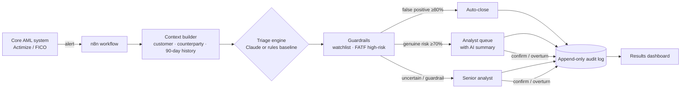

# Intelligent AML Alert Triage

**An AI triage layer that sits on top of existing AML monitoring systems (Actimize, FICO) and decides which alerts actually need a human, with an explainable, append-only audit trail for every decision.**

Saudi banks already run SAMA-mandated transaction monitoring. Detection is a solved problem. **Triage is not.** Most alerts are false positives, and compliance analysts spend most of their day clearing them one by one. This project automates that triage step without replacing anything the bank already has.



## Results

| Run | Auto-closed | Genuine risks missed | Analyst time saved |
|---|---|---|---|
| Rules baseline (practice mode) | 68% | 0 / 309 | 95% |
| Claude | *pending* | *pending* | *pending* |

> **The rules baseline is not a real-world claim.** It was written with knowledge of how the demo data was generated, so it shows the pipeline works end to end; it does not show accuracy. The Claude run is the real test. See [docs/BUSINESS_CASE.md](docs/BUSINESS_CASE.md) for the workload model.

## What's inside

| Component | File | What it does |
|---|---|---|
| Demo bank | `scripts/generate_data.py` | 560 customers, ~14.7k transactions, 1,000 alerts across 13 realistic Saudi scenarios (69% false positives, ~15% deliberately ambiguous) |
| Context builder | `scripts/context.py` | Assembles the case file an analyst would build by hand. Uses only data available at alert time, and never the answer. |
| Triage engine | `scripts/triage_engine.py`, `scripts/prompt.py` | Claude, or a transparent rules baseline, returns assessment + confidence + reasoning. Routing thresholds and guardrails are applied in code. |
| API | `scripts/api.py` | Flask endpoints n8n calls: `/alerts`, `/triage`, `/alerts/<id>/context`, `/alerts/<id>/history`, `/alerts/<id>/review`, `/dashboard` |
| Orchestration | `n8n/aml_alert_triage_workflow.json` | Webhook or batch trigger → triage → route to close / analyst / senior |
| Audit trail | `scripts/audit_logger.py` | Append-only log (DB triggers block UPDATE/DELETE), analyst confirm/overturn, per-alert history |
| Dashboard | `scripts/dashboard.py` | Self-contained HTML: outcomes, accuracy, analyst feedback, hours and cost saved, every decision with its reasoning |
| Business case | `scripts/business_case.py` | Reproducible ROI model with conservative / base / optimistic scenarios |

## Design decisions

- **Layer on top, don't replace.** The engine consumes alerts the core system already raised. No re-detection, no rip-and-replace.
- **Fail safe.** Any error routes to a senior analyst. The engine never auto-closes on failure.
- **Guardrails beat the model.** Watchlist hits and FATF high-risk jurisdictions always go to a human, whatever the AI says.
- **Explainable by default.** Every decision stores model, prompt version, confidence, risk factors and reasoning.
- **Measured, not claimed.** Ground truth is kept apart from what the engine sees and is used only to score it. A rules baseline exists so Claude's contribution can be measured against it.
- **Feedback loop.** Analyst overrides are logged; the override rate is the signal for monitoring how the model performs over time.

## Quick start

```powershell
python -m venv .venv
.\.venv\Scripts\Activate.ps1          # macOS/Linux: source .venv/bin/activate
pip install -r requirements.txt
copy .env.example .env                # add ANTHROPIC_API_KEY to use Claude; leave empty for practice mode

python -m scripts.generate_data       # build the demo bank
python -m scripts.run_batch           # triage all 1,000 alerts and score against ground truth
python -m scripts.audit_logger simulate-reviews
python -m scripts.dashboard           # opens reports/dashboard.html
python -m pytest -q                   # 13 tests
```

Or with Docker: `cd docker` then `docker compose up --build`, and open http://localhost:5000/dashboard.

Full setup, including n8n: [docs/DEPLOYMENT.md](docs/DEPLOYMENT.md) · System design: [docs/ARCHITECTURE.md](docs/ARCHITECTURE.md)

## Limitations

- All data is synthetic. Real alert data would have messier context and no ground truth. In production, accuracy would be measured on historical analyst decisions.
- Workload figures (30-minute manual review, 5–20-minute assisted review) are assumptions to validate with a bank's own time studies.
- Auto-closing alerts would require model-risk governance and regulator engagement before production use. The design supports this (versioned prompts, full audit trail, QA sampling), but it is not a substitute for that work.

**Tech:** Python · Flask · SQLite · Claude API · n8n · Docker
